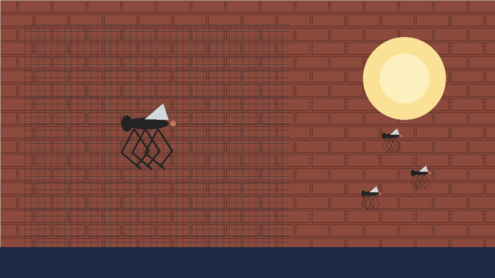
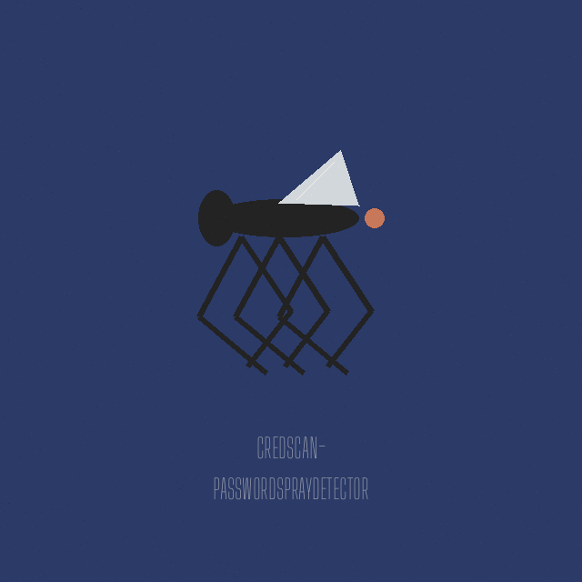
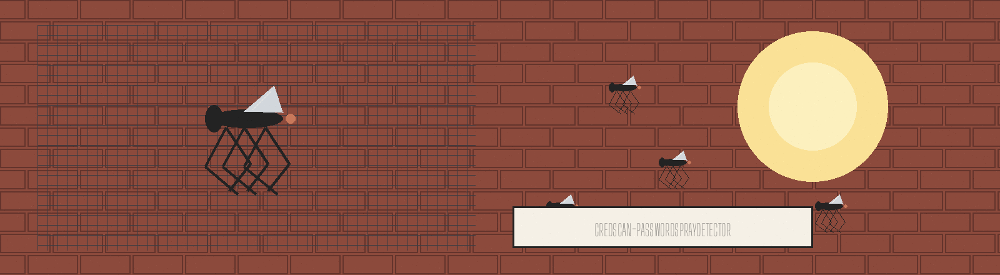
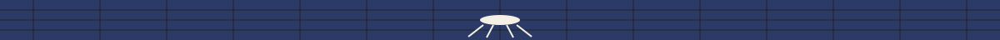
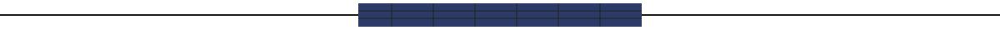

# credscan-PasswordSprayDetector

Title block: the name above is set in Big Shoulders Inline Display SC as the themed label for The Crane Fly September Invasion, with a fine ruled line beneath it. The small mark below stands beside this first heading only; the remaining headings keep the treatment without the image.

# credscan-PasswordSprayDetector
Analyzes authentication logs to detect password spraying attacks. It identifies patterns of failed login attempts across multiple accounts originating from the same source IP: the account named in each log line is parsed, failures are grouped by source IP, and spraying is flagged only when the failures from one IP reach the threshold across distinct accounts. Failures that reach the threshold against fewer accounts, for example repeated failures against a single account, are flagged separately as a potential brute force attack, not as spraying. - Focused on Scans code repositories, log files, and other text-based artifacts for inadvertently exposed credentials, API keys, or other sensitive information. Uses regular expressions and heuristics to identify potential leaks. Includes domain parsing to flag suspicious URLs.

## Install

> **Ledger note: the narrow matching rule.** Only two failure wordings count: Failed login and Authentication failure. The account comes before the address in both, an optional user word may sit before the account, and the address must be an IPv4 address. Other wordings and other field orders count for nothing.

`git clone https://github.com/ShadowStrikeHQ/credscan-passwordspraydetector`

## Usage

> **Ledger note: distinct accounts decide.** Failures are grouped by source address and accounts are collected per address as a set. Spraying is flagged when distinct accounts from one address reach the threshold; brute force is flagged when raw failures reach the threshold but distinct accounts do not.

`./credscan-passwordspraydetector [params]`

## Parameters

> **Ledger note: logs from a leak run hold values.** Matched text is logged in full by the code, including the value that follows a pattern keyword. A saved log from a leak run holds the values it found and must be handled as secret material. No value is shown on this page or in this README; pattern names and conduct only are stated.

- `-h`: Show help message and exit
- `--threshold`: Threshold for failed login attempts from the same IP. Spraying requires this count across distinct accounts; the same count against fewer accounts is reported as brute force.
- `--domains`: No description provided

## License

> **Ledger note: findings do not fail the run.** Spraying found still exits 0. Leaks found still exits 0. Clean scans also exit 0. A missing input file and other read failures exit 1.

Copyright (c) ShadowStrikeHQ

## Themed account: facts taken from the code

### Two Commands, Not One

Two commands exist. Their names are spray and leak. The README headline stresses spraying; the code gives both commands equal standing, so this ledger lists both and folds neither into the other.

### Distinct Accounts Decide Spraying

The spray form is spray followed by a log file path, which is required, and the file is read line by line. Only two failure wordings count: Failed login and Authentication failure, with the account before the address, an optional user word before the account, and an IPv4 address. Failures are grouped by source address, accounts are collected per address as a set, and distinct accounts are counted. Spraying is flagged when distinct accounts from one address reach the threshold, whose default is 5. Brute force is flagged when raw failures from one address reach the threshold but distinct accounts do not. Both verdicts are warnings giving the address, the raw failure count, and the distinct account count. A clean result keeps its narrow sense: no spraying attacks were detected on that threshold.

### Pattern Names Only

The leak form is leak followed by a file path, which is required, and the file is read whole with read errors ignored at character level. The pattern names are five: API Key, Password, Email, AWS Key, and Secret Key. Names only are listed here; no values are shown and no example string is printed.

### Logs From a Leak Run Hold Values

Matched text is logged in full by the code, including the value after a Password or Secret Key keyword. A saved log from a leak run holds the values it found. Handle that log as secret material.

### Domain Check Inside Leak Only

The option is --domains and it takes zero or more domain values. URLs beginning http or https are found first, each URL is reduced to its registered domain by tldextract, the subdomain part is dropped, and a listed registered domain matches while a listed subdomain alone does not. Flagged URLs are logged as warnings with the domain named.

### Install and Running Forms

Install line as printed in the README, wrong organisation and all: git clone https://github.com/ShadowStrikeHQ/credscan-passwordspraydetector . Note: that line names ShadowStrikeHQ, which is not the organisation that holds this repository; it is shown as printed and flagged here. The correct running forms are python3 main.py spray LOG_FILE and python3 main.py leak FILE_PATH. Neither is shortened to brackets.

### Controls Split by Command

Help is -h and prints help and exits. For spray, log_file is required and --threshold is a whole number with default 5 and the distinct account meaning stated above. For leak, file_path is required and --domains takes a list and defaults to none, so no URL check runs without it. The README order mixes the two commands; this page separates them by command.

### Endings

No command given prints help and exits 1. A missing input file ends that command in failure and the run exits 1; other read errors do the same. Findings do not change the exit: spraying found still exits 0, leaks found still exits 0, and clean scans also exit 0.

### Licence

The README gives a copyright line in the wrong name, preserved verbatim below. The separate LICENSE file carries the MIT License, and its holder line carries the owner legal surname, a fact recorded here without that surname being reproduced.

Kit buttons on the site read: Count Failures by Address, Scan One File for Leaks, Set the Distinct Account Threshold, List Domains to Flag, Show Help.
